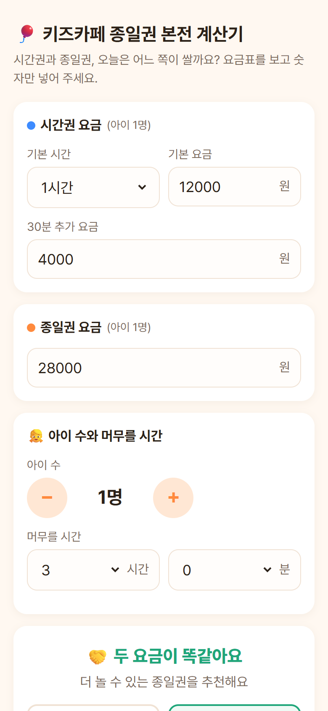
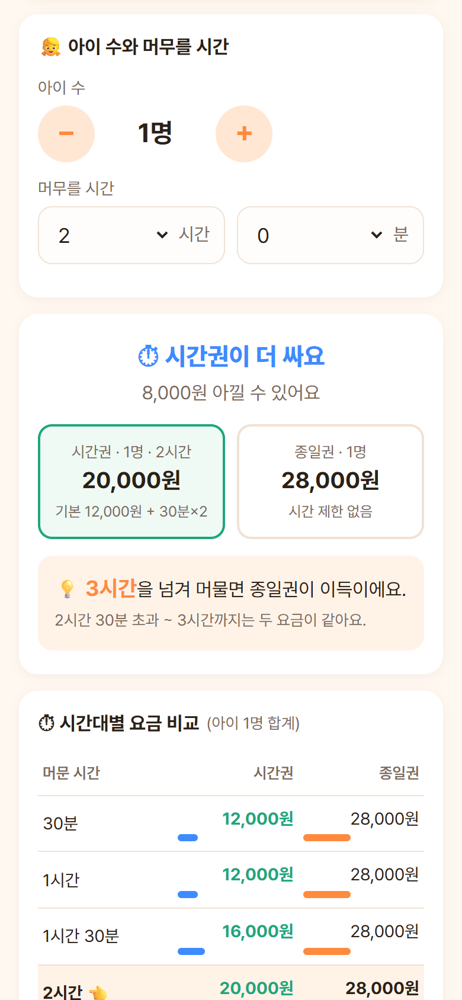
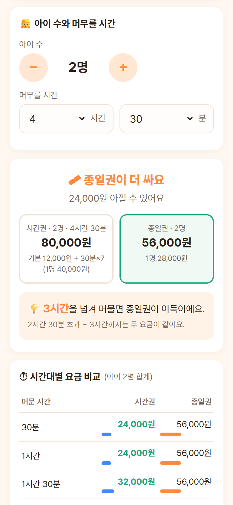
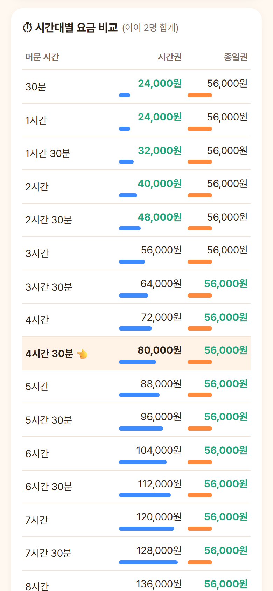
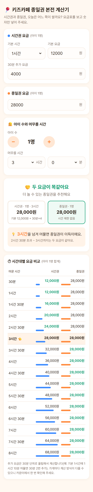

<div align="center">

# 🎈 키즈카페 종일권 본전 계산기

**시간권과 종일권, 오늘은 어느 쪽이 쌀까요?**<br>
카운터 앞 요금표를 보고 숫자만 넣으면, 몇 시간부터 종일권이 이득인지 바로 알려 줍니다.


<br>


&nbsp;&nbsp;

&nbsp;&nbsp;


</div>

---

## 어떤 앱인가요?

키즈카페는 보통 **시간권**(기본 시간 + 30분마다 추가 요금)과 **종일권**(시간 제한 없이 한 번에 결제) 두 가지를 팝니다.
"오늘 3시간쯤 놀 것 같은데 종일권 끊을까?"를 매번 암산하기 번거로워서 만든 작은 계산기입니다.

| | 하는 일 |
|---|---|
| ⚖️ **판정** | 지금 넣은 시간 기준으로 시간권과 종일권 중 어느 쪽이 싼지, 얼마나 아끼는지 보여 줍니다 |
| 💡 **손익분기점** | "**○시간**을 넘겨 머물면 종일권이 이득"처럼 갈아타는 시점을 짚어 줍니다 |
| 👧 **아이 여러 명** | 아이 수(1~10명)를 곱해 가족 전체 금액으로 비교합니다 |
| ⏱ **시간대별 비교표** | 30분 단위로 두 요금을 나란히 놓고, 더 싼 쪽을 초록색으로 표시합니다 |
| 💾 **요금 기억** | 마지막으로 넣은 요금을 폰(`localStorage`)에 저장해 두어 다음에 다시 칠 필요가 없습니다 |

서버도, 로그인도, 광고도 없습니다. `index.html` 파일 하나가 전부입니다.

---

## 쓰는 법

### 1. 열기

- **폰에서**: `index.html` 을 폰에 받아 브라우저로 열거나, 웹에 올려 둔 주소로 들어갑니다. 홈 화면에 추가해 두면 앱처럼 쓸 수 있습니다.
- **PC에서**: 저장소를 받은 뒤 `index.html` 을 더블클릭합니다.

```bash
git clone https://github.com/hull-kr/kidscafe-pass.git
cd kidscafe-pass
# index.html 을 브라우저로 엽니다
```

### 2. 입력하기

<table>
<tr>
<td width="290" valign="top"></td>
<td valign="top">

**① 시간권 요금** (아이 1명 기준)
- **기본 시간**: 30분 ~ 3시간 중 선택
- **기본 요금**: 기본 시간 동안의 요금
- **30분 추가 요금**: 기본 시간을 넘기면 30분마다 붙는 요금

**② 종일권 요금** (아이 1명 기준)

**③ 아이 수와 머무를 시간**
- `−` `+` 버튼으로 아이 수를 정합니다
- 머무를 시간을 시간·분(10분 단위)으로 고릅니다

숫자를 바꾸는 즉시 아래 결과가 다시 계산됩니다. 따로 누를 버튼이 없습니다.

</td>
</tr>
</table>

### 3. 결과 보기

<table>
<tr>
<th>⏱ 시간권이 쌀 때<br><sub>아이 1명 · 2시간</sub></th>
<th>🎟 종일권이 쌀 때<br><sub>아이 2명 · 4시간 30분</sub></th>
</tr>
<tr>
<td></td>
<td></td>
</tr>
<tr>
<td valign="top">시간권 20,000원 vs 종일권 28,000원<br>→ <b>8,000원</b> 아낄 수 있어요</td>
<td valign="top">시간권 80,000원 vs 종일권 56,000원<br>→ <b>24,000원</b> 아낄 수 있어요</td>
</tr>
</table>

- 더 싼 쪽 칸이 **초록 테두리**로 강조됩니다.
- 아래 💡 칸에서 **언제부터 종일권이 이득인지** 확인할 수 있습니다.
- 두 요금이 똑같으면 "🤝 두 요금이 똑같아요"와 함께 더 오래 놀 수 있는 종일권을 추천합니다.

### 4. 시간대별 비교표

<table>
<tr>
<td width="290" valign="top"></td>
<td valign="top">

30분 단위로 **최대 8시간**까지(머무를 시간이 더 길면 거기까지) 두 요금을 나란히 보여 줍니다.

- 초록 글씨 = 그 시간대에 더 싼 쪽
- 막대 = 금액 크기(파랑 시간권, 주황 종일권)
- 👈 표시 줄 = 지금 고른 머무를 시간

"조금 더 놀다 갈까?" 싶을 때 30분 늘리면 얼마가 되는지 한눈에 볼 수 있습니다.

</td>
</tr>
</table>

---

## 계산 방식

### 시간권 요금

기본 시간을 넘긴 부분은 **30분 단위로 올림**합니다.

```
시간권(1명) = 기본 요금 + ⌈ (머문 시간 − 기본 시간) ÷ 30분 ⌉ × 30분 추가 요금
가족 합계  = 1명 요금 × 아이 수
```

> 예) 기본 1시간 12,000원, 30분 추가 4,000원, **1시간 10분** 머묾<br>
> → 넘긴 10분도 30분 1번으로 올림 → 12,000 + 4,000 × **1** = **16,000원**

### 종일권 요금

```
종일권 합계 = 종일권 요금 × 아이 수   (머문 시간과 무관)
```

### 손익분기점 (언제부터 종일권이 이득인가)

시간권이 종일권보다 **비싸지기 시작하는** 추가 횟수 `k` 를 찾습니다.

```
k        = ⌊ (종일권 − 기본 요금) ÷ 30분 추가 요금 ⌋ + 1
분기 시각 = 기본 시간 + (k − 1) × 30분
```

이 시각을 **넘겨** 머물면 종일권이 더 쌉니다. 아이 수는 양쪽에 똑같이 곱해지므로 분기 시각에 영향을 주지 않습니다.

> 예) 기본 1시간 12,000원, 30분 추가 4,000원, 종일권 28,000원<br>
> → k = ⌊ 16,000 ÷ 4,000 ⌋ + 1 = **5**<br>
> → 분기 시각 = 1시간 + 4 × 30분 = **3시간**<br>
> → **3시간을 넘겨 머물면 종일권이 이득**. 2시간 30분 초과 ~ 3시간까지는 두 요금이 28,000원으로 같습니다.

| 머문 시간 | 추가 횟수 | 시간권 | 종일권 | 더 싼 쪽 |
|---|:---:|---:|---:|:---:|
| 1시간 | 0 | 12,000원 | 28,000원 | ⏱ 시간권 |
| 2시간 | 2 | 20,000원 | 28,000원 | ⏱ 시간권 |
| 3시간 | 4 | 28,000원 | 28,000원 | 🤝 같음 |
| 3시간 10분 | 5 | 32,000원 | 28,000원 | 🎟 종일권 |
| 4시간 | 6 | 36,000원 | 28,000원 | 🎟 종일권 |

### 특수한 경우

| 상황 | 결과 |
|---|---|
| 기본 요금 > 종일권 요금 | 몇 분을 있든 **종일권**이 이득 |
| 30분 추가 요금 = 0원 | 시간권 요금이 오르지 않으므로 **시간권**이 계속 이득 |
| 분기 시각이 12시간을 넘김 | 하루 안에 그만큼 머물기 어려우니 시간권이 유리할 가능성이 크다고 덧붙임 |

> ⚠️ 추가 요금을 몇 분 단위로 끊는지, 유예 시간(예: 10분까지 무료)이 있는지는 가게마다 다릅니다. 이 계산기는 **30분 단위 올림**만 가정하니, 애매하면 카운터에서 한 번 확인해 주세요.

---

<details>
<summary><b>📱 전체 화면 한 장으로 보기</b></summary>
<br>
<div align="center">

</div>
</details>

## 파일 구성

```
kidscafe-pass/
├── index.html              # 앱 전체 (HTML + CSS + JS 한 파일)
└── docs/screenshots/       # README 에 쓰는 폰 화면 캡처 (390×844, 2배율)
```
